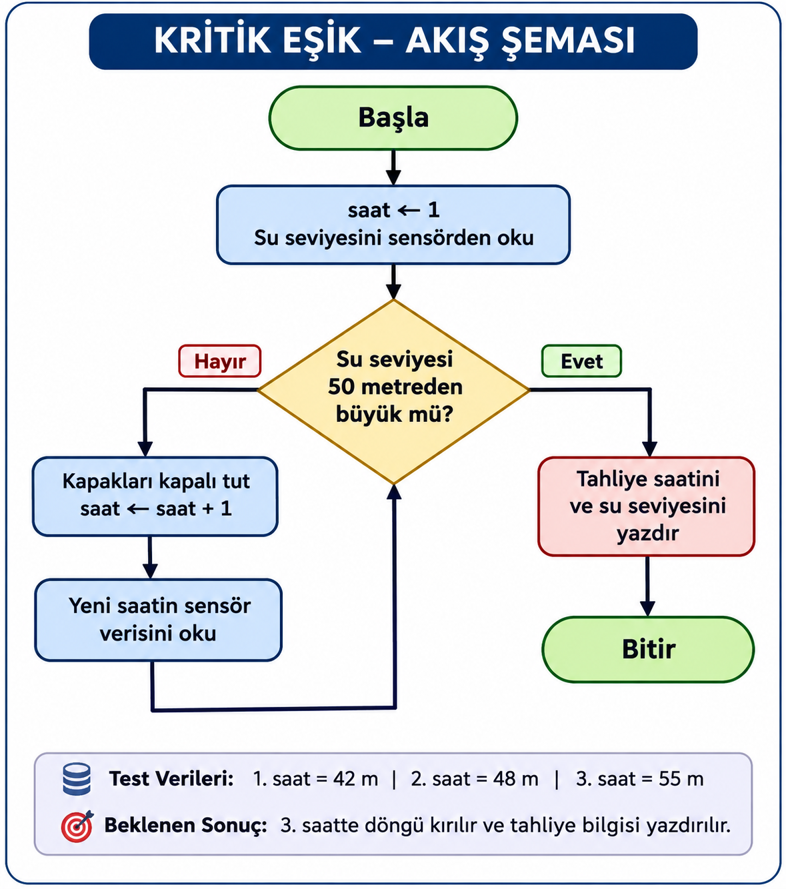
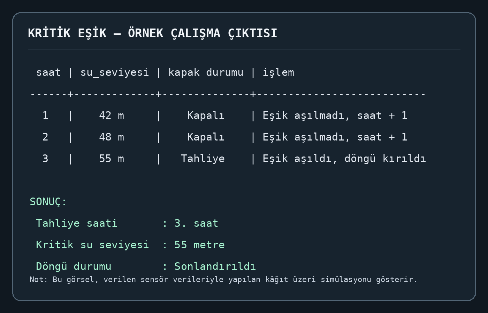

🚀 Kod-Asistan v0.1

👨‍💻 Proje Yazarı: Sami YENCİLEK

🎯 Projenin Amacı

Kod-Asistan, kullanıcıların günlük işlerini kolaylaştırmak amacıyla geliştirilen bir dijital asistan projesidir. Hesaplama, selamlama ve benzeri temel işlemleri gerçekleştirebilen bir yapı oluşturmak hedeflenmektedir.

Projenin temel amacı, yazılım geliştirme ve algoritmik düşünme becerilerini kullanarak zaman içerisinde daha gelişmiş özelliklere sahip bir dijital asistan ortaya çıkarmaktır.

📌 Projenin Hedefleri

Kod-Asistan'ın ilerleyen sürümlerde yeni özellikler kazanması ve kullanıcı ihtiyaçlarına daha kapsamlı çözümler sunması hedeflenmektedir.

🛣️ Gelişim Yol Haritası

Sürüm| Planlanan Özellikler
v0.1| Temel dijital asistan ve örnek algoritma uygulamaları
v1.0| Akıllı menü ve kullanıcı etkileşimi
v2.0| Veri saklama ve kullanıcı tercihlerini hatırlama
v3.0| Gelişmiş asistan özellikleri

Not: Yol haritasındaki özellikler geliştirme sürecinde güncellenebilir.

📂 Projenin Kapsamı

Kod-Asistan projesi kapsamında, kullanıcıların günlük işlemlerini kolaylaştıracak temel yazılım uygulamalarının geliştirilmesi amaçlanmaktadır.

Projenin geliştirme sürecinde algoritmik düşünme, problem çözme, karar yapıları ve döngüler gibi temel programlama konularından yararlanılmaktadır.

Bu kapsamda hazırlanan örnek uygulamalardan biri de akıllı baraj otomasyonunda su seviyesinin kontrol edilmesini sağlayan KRİTİK EŞİK algoritmasıdır.

💻 Örnek Algoritma Uygulaması: KRİTİK EŞİK

Bu uygulamada, akıllı baraj otomasyonunda su seviyesini saatlik olarak takip eden bir döngü mekanizması modellenmiştir.

Sistemde başlangıç saati 1 olarak belirlenir. Her saat sensörden alınan su seviyesi kontrol edilir.

Su seviyesi 50 metreyi aşmadığı sürece baraj kapakları kapalı tutulur ve saat sayacı bir artırılır. Su seviyesi 50 metreyi aştığında döngü sonlandırılır. Ardından tahliyenin gerçekleştiği saat ve kritik su seviyesi ekrana yazdırılır.

🔢 KRİTİK EŞİK Sözde Kodu

1. Saat değişkenini 1 olarak başlat.
2. Su seviyesini sensörden oku.
3. Su seviyesi 50 metreden büyük mü kontrol et.
4. Eğer su seviyesi 50 metreden büyükse:
   - Döngüyü sonlandır.
   - Tahliye saatini ekrana yazdır.
   - Kritik su seviyesini ekrana yazdır.
5. Eğer su seviyesi 50 metre veya daha düşükse:
   - Baraj kapaklarını kapalı tut.
   - Saat değişkenini 1 artır.
   - Yeni saatin su seviyesi verisini oku.
6. Su seviyesi kritik eşiği aşana kadar işlemleri tekrarla.

🖼️ Proje Görselleştirmeleri

🔄 KRİTİK EŞİK Akış Şeması

Aşağıdaki akış şeması, barajdaki su seviyesinin kontrol edilmesini ve 50 metre kritik eşiğinin aşılması durumunda döngünün sonlandırılmasını göstermektedir.

🖥️ Örnek Çalışma Çıktısı

Verilen saatlik sensör verileriyle yapılan simülasyonda su seviyesinin 3. saatte 55 metreye ulaşması sonucunda döngü sonlandırılmıştır.

📚 Kaynakça

- Millî Eğitim Bakanlığı. (2026). Bilişim Teknolojileri Alanı / Programlama Temelleri Ders Kitabı. Millî Eğitim Bakanlığı Yayınları.

🤝 Etik İlke

Bu proje hazırlanırken yararlanılan kaynaklara saygı gösterilmiş, doğruluk ve dürüstlük ilkeleri benimsenmiştir. Ahilik kültüründeki ustaya saygı ve emeğe değer verme anlayışı, yazılım geliştirme sürecinde kaynak gösterme ve fikrî emeğe saygı ilkeleriyle ilişkilendirilmiştir.

---

🌟 Kod-Asistan: Öğrenerek gelişen, geliştikçe güçlenen bir dijital asistan projesi.