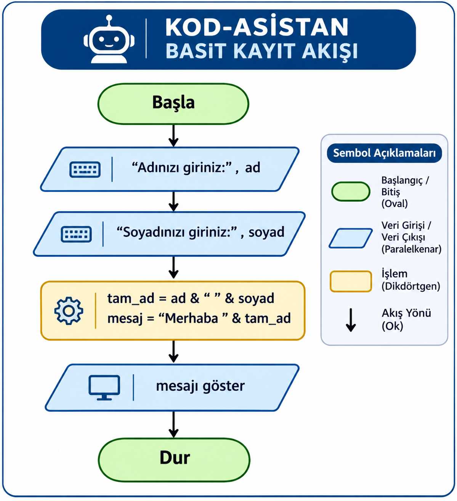

🚀 Kod-Asistan Projesi

👨‍💻 Proje Yazarı: Sami YENCİLEK

🎯 Projenin Amacı

Kod-Asistan, kullanıcıların günlük işlerini kolaylaştırmak amacıyla geliştirilen bir dijital asistan projesidir. Hesaplama, selamlama ve benzeri temel işlemleri gerçekleştirebilen bir yapı oluşturmak hedeflenmektedir.

Projenin temel amacı, yazılım geliştirme ve algoritmik düşünme becerilerini kullanarak zaman içerisinde daha gelişmiş özelliklere sahip bir dijital asistan ortaya çıkarmaktır.

📌 Projenin Hedefleri

Kod-Asistan'ın ilerleyen sürümlerde yeni özellikler kazanması ve kullanıcı ihtiyaçlarına daha kapsamlı çözümler sunması hedeflenmektedir.

🛣️ Gelişim Yol Haritası

🟢 v0.1 – Başlangıç

- Temel algoritmalar ve akış şemaları.
- Kod-Asistan projesinin ilk tasarımı.
- Örnek algoritma uygulamaları.

🔵 v0.2 – Temel Python ve Profil Modülü

- Değişkenler ve veri türleri.
- Kullanıcıdan veri alma ve tip dönüşümleri.
- Yaş hesaplama ve temel matematiksel işlemler.
- Aritmetiksel, ilişkisel ve mantıksal operatörler.

🟡 v0.3 – Akıllı Menü ve Döngüsel Yapılar

- Koşul ve karar yapıları ("if", "elif", "else").
- Kullanıcı etkileşimli akıllı menü sistemi.
- "while" ve "for" döngüleri.
- Liste işlemleri ve döngü kontrol ifadeleri.
- "turtle" ile grafiksel görselleştirme.

🟣 v1.0 – İlk Kararlı Sürüm

- Koşul yapıları, döngüler ve liste işlemlerinin bütünleştirilmesi.
- Grafiksel görselleştirme modüllerinin tamamlanması.
- İlk kararlı sürümün test edilmesi.
- GitHub üzerinde ilk resmî Release yayımlanması.

🟠 v2.0 – Veri Yönetimi

- Veri saklama ve dosya işlemleri.
- Kullanıcı bilgilerinin düzenlenmesi.
- Kullanıcı tercihlerinin yönetilmesi.
- Veri yönetimi özelliklerinin geliştirilmesi.

🔴 v3.0 – Büyük Final

- Hata yönetimi ve program kararlılığı.
- JSON ile kalıcı veri saklama.
- Modüler programlama ve fonksiyonlar.
- Veri güvenliği ve KVKK ilkeleri.
- Profesyonel README dokümantasyonu.
- GitHub Release v3.0 yayımlanması.
- Projenin dijital portfolyo üzerinden sunulması.

---

📚 Proje Notu: Kod-Asistan, Programlama Temelleri 9 ders kitabındaki uygulamalar esas alınarak aşamalı biçimde geliştirilmektedir. Her sürüm, ilgili uygulamalar tamamlandıkça projeye dâhil edilecektir.

📂 Projenin Kapsamı

Kod-Asistan projesi kapsamında, kullanıcıların günlük işlemlerini kolaylaştıracak temel yazılım uygulamalarının geliştirilmesi amaçlanmaktadır.

Projenin geliştirme sürecinde algoritmik düşünme, problem çözme, karar yapıları ve döngüler gibi temel programlama konularından yararlanılmaktadır.

Bu kapsamda hazırlanan örnek uygulamalardan biri de akıllı baraj otomasyonunda su seviyesinin kontrol edilmesini sağlayan KRİTİK EŞİK algoritmasıdır.

💻 Örnek Algoritma Uygulaması: KRİTİK EŞİK

Bu uygulamada, akıllı baraj otomasyonunda su seviyesini saatlik olarak takip eden bir döngü mekanizması modellenmiştir.

Sistemde başlangıç saati 1 olarak belirlenir. Her saat sensörden alınan su seviyesi kontrol edilir.

Su seviyesi 50 metreyi aşmadığı sürece baraj kapakları kapalı tutulur ve saat sayacı bir artırılır. Su seviyesi 50 metreyi aştığında döngü sonlandırılır. Ardından tahliyenin gerçekleştiği saat ve kritik su seviyesi ekrana yazdırılır.

🔢 KRİTİK EŞİK Sözde Kodu

1. Saat değişkenini 1 olarak başlat.
2. Su seviyesini sensörden oku.
3. Su seviyesi 50 metreden büyük mü kontrol et.
4. Eğer su seviyesi 50 metreden büyükse:
   - Döngüyü sonlandır.
   - Tahliye saatini ekrana yazdır.
   - Kritik su seviyesini ekrana yazdır.
5. Eğer su seviyesi 50 metre veya daha düşükse:
   - Baraj kapaklarını kapalı tut.
   - Saat değişkenini 1 artır.
   - Yeni saatin su seviyesi verisini oku.
6. Su seviyesi kritik eşiği aşana kadar işlemleri tekrarla.

🖼️ Proje Görselleştirmeleri

🔄 KRİTİK EŞİK Akış Şeması

Aşağıdaki akış şeması, barajdaki su seviyesinin kontrol edilmesini ve 50 metre kritik eşiğinin aşılması durumunda döngünün sonlandırılmasını göstermektedir.

🖥️ Örnek Çalışma Çıktısı

Verilen saatlik sensör verileriyle yapılan simülasyonda su seviyesinin 3. saatte 55 metreye ulaşması sonucunda döngü sonlandırılmıştır.

## 🤖 Kod-Asistan Basit Kayıt Akışı

### 🎯 Uygulamanın Amacı
Kullanıcıdan ad ve soyadı bilgilerini ayrı ayrı almak, bu bilgileri birleştirerek kişiye özel selamlama mesajı oluşturmak.

### 🔄 Akış Şeması

### ✅ Uygulama Sonucu
- 👤 Kullanıcının ad ve soyadı ayrı ayrı alınır.
- 🔗 Ad ve soyadı birleştirilir.
- 💬 Kullanıcıya özel selamlama mesajı oluşturulur.
- 🏁 Algoritma sonlandırılır.

📚 Kaynakça

- Millî Eğitim Bakanlığı. (2026). Bilişim Teknolojileri Alanı / Programlama Temelleri Ders Kitabı. Millî Eğitim Bakanlığı Yayınları.

🤝 Etik İlke

Bu proje hazırlanırken yararlanılan kaynaklara saygı gösterilmiş, doğruluk ve dürüstlük ilkeleri benimsenmiştir. Ahilik kültüründeki ustaya saygı ve emeğe değer verme anlayışı, yazılım geliştirme sürecinde kaynak gösterme ve fikrî emeğe saygı ilkeleriyle ilişkilendirilmiştir.

---

🌟 Kod-Asistan: Öğrenerek gelişen, geliştikçe güçlenen bir dijital asistan projesi.
